# Cthugha Reborn initiatives

Planned work for Cthugha Reborn: features, fixes, performance and tooling for the app, render pipeline and remote UI.

<!-- brindley:generated:begin — do not edit by hand; regenerate instead -->

### Active

| # | Initiative | Type | Status | Ready / blocked by | Open Qs | Owner |
|---|------------|------|--------|--------------------|---------|-------|
| 1 | [Size the internal render buffer from the display at a chosen resolution](01-cap-the-internal-render-resolution-at-high-window-sizes.md) | perf | draft | — | 1 | — |
| 6 | [Throttle tab regeneration driven by animation bindings](06-throttle-tab-regeneration-driven-by-animation-bindings.md) | bug | draft | — | 0 | — |
| 7 | [Upload video frames asynchronously via pixel buffer objects](07-upload-video-frames-asynchronously-via-pixel-buffer-objects.md) | perf | draft | — | 0 | — |
| 8 | [Make the flame simulation independent of display frame rate](08-make-the-flame-simulation-independent-of-display-frame-rate.md) | feature | draft | — | 0 | — |
| 9 | [Decouple simulation from display with interpolated presentation](09-decouple-simulation-from-display-with-interpolated-presentat.md) | spike | draft | — | 0 | — |
| 10 | [Make primitive parameter values safe to read across threads](10-make-primitive-parameter-values-safe-to-read-across-threads.md) | bug | draft | — | 0 | — |
| 12 | [Global animatable transform applied to the whole render](12-global-animatable-transform-applied-to-the-whole-render.md) | feature | draft | — | 0 | — |
| 13 | [Gradient-based palette designer](13-gradient-based-palette-designer.md) | feature | draft | — | 0 | — |
| 14 | [Random saved tab preset action](14-random-saved-tab-preset-action.md) | feature | draft | — | 0 | — |
| 15 | [Regenerate action to reseed partly-random tab generators](15-regenerate-action-to-reseed-partly-random-tab-generators.md) | feature | draft | — | 0 | — |
| 16 | [Per-type notification toggles](16-per-type-notification-toggles.md) | feature | draft | — | 0 | — |
| 17 | [Browsable documentation of the parameter tree](17-browsable-documentation-of-the-parameter-tree.md) | feature | draft | — | 0 | — |
| 18 | [MCP interface for agent control and scripting](18-mcp-interface-for-agent-control-and-scripting.md) | feature | draft | — | 0 | — |
| 19 | [Live quotes from an external source](19-live-quotes-from-an-external-source.md) | feature | draft | — | 0 | — |
| 20 | [Named animation packages with their own dials](20-named-animation-packages-with-their-own-dials.md) | feature | draft | — | 0 | — |
| 21 | [Make TransformParams easy to animate](21-make-transformparams-easy-to-animate.md) | feature | draft | — | 6 | — |
| 22 | [Migrate to Jackson 3](22-migrate-to-jackson-3.md) | chore | draft | — | 0 | — |
| 23 | [Migrate the remote server to Javalin 7](23-migrate-the-remote-server-to-javalin-7.md) | chore | draft | — | 0 | — |
| 24 | [Migrate tests to JUnit 6](24-migrate-tests-to-junit-6.md) | chore | draft | — | 0 | — |
| 25 | [Move the remote-ui toolchain to its new major versions](25-move-the-remote-ui-toolchain-to-its-new-major-versions.md) | chore | draft | — | 0 | — |

### Dependencies

```mermaid
flowchart RL
  n1["✏️ 1 Size the internal render buffer from the display at a chosen resolution"]
  n6["✏️ 6 Throttle tab regeneration driven by animation bindings"]
  n7["✏️ 7 Upload video frames asynchronously via pixel buffer objects"]
  n8["✏️ 8 Make the flame simulation independent of display frame rate"]
  n9["✏️ 9 Decouple simulation from display with interpolated presentation"]
  n10["✏️ 10 Make primitive parameter values safe to read across threads"]
  n12["✏️ 12 Global animatable transform applied to the whole render"]
  n13["✏️ 13 Gradient-based palette designer"]
  n14["✏️ 14 Random saved tab preset action"]
  n15["✏️ 15 Regenerate action to reseed partly-random tab generators"]
  n16["✏️ 16 Per-type notification toggles"]
  n17["✏️ 17 Browsable documentation of the parameter tree"]
  n18["✏️ 18 MCP interface for agent control and scripting"]
  n19["✏️ 19 Live quotes from an external source"]
  n20["✏️ 20 Named animation packages with their own dials"]
  n21["✏️ 21 Make TransformParams easy to animate"]
  n22["✏️ 22 Migrate to Jackson 3"]
  n23["✏️ 23 Migrate the remote server to Javalin 7"]
  n24["✏️ 24 Migrate tests to JUnit 6"]
  n25["✏️ 25 Move the remote-ui toolchain to its new major versions"]
  n3["✅ <s>3 Update all dependencies to their latest releases</s>"]
  n22 --> n3
  n23 --> n3
  n24 --> n3
  n25 --> n3
  click n1 href "01-cap-the-internal-render-resolution-at-high-window-sizes.md"
  click n6 href "06-throttle-tab-regeneration-driven-by-animation-bindings.md"
  click n7 href "07-upload-video-frames-asynchronously-via-pixel-buffer-objects.md"
  click n8 href "08-make-the-flame-simulation-independent-of-display-frame-rate.md"
  click n9 href "09-decouple-simulation-from-display-with-interpolated-presentat.md"
  click n10 href "10-make-primitive-parameter-values-safe-to-read-across-threads.md"
  click n12 href "12-global-animatable-transform-applied-to-the-whole-render.md"
  click n13 href "13-gradient-based-palette-designer.md"
  click n14 href "14-random-saved-tab-preset-action.md"
  click n15 href "15-regenerate-action-to-reseed-partly-random-tab-generators.md"
  click n16 href "16-per-type-notification-toggles.md"
  click n17 href "17-browsable-documentation-of-the-parameter-tree.md"
  click n18 href "18-mcp-interface-for-agent-control-and-scripting.md"
  click n19 href "19-live-quotes-from-an-external-source.md"
  click n20 href "20-named-animation-packages-with-their-own-dials.md"
  click n21 href "21-make-transformparams-easy-to-animate.md"
  click n22 href "22-migrate-to-jackson-3.md"
  click n23 href "23-migrate-the-remote-server-to-javalin-7.md"
  click n24 href "24-migrate-tests-to-junit-6.md"
  click n25 href "25-move-the-remote-ui-toolchain-to-its-new-major-versions.md"
  click n3 href "03-update-all-dependencies-to-their-latest-releases.md"
```

### Themes

- **agent-control** — Driving and documenting the app programmatically: parameter-tree docs, MCP, live content · 3 open, 0 closed or deferred
- **remote-ui** — Work mostly in the React remote UI (:remote-ui) · 3 open, 0 closed or deferred
- **render-core** — Fixes that land upstream in the render-core library, then get picked up here · 0 open, 3 closed or deferred
- **smoothness** — Frame pacing and render-loop performance: stalls, dropped frames, per-frame cost · 5 open, 2 closed or deferred
- **tab-generators** — Translation-table generators, presets and their regeneration · 3 open, 0 closed or deferred
- **transforms** — Affine/perspective transforms (TransformParams) and animating them · 3 open, 0 closed or deferred
- **upgrades** — Major-version dependency and toolchain migrations · 4 open, 1 closed or deferred

### Completed

| # | Initiative | Type | Updated |
|---|------------|------|---------|
| 2 | [Bundle a pinned JDK 25 runtime with the app](02-bundle-a-pinned-jdk-25-runtime-with-the-app.md) | build | 2026-10-24 |
| 3 | [Update all dependencies to their latest releases](03-update-all-dependencies-to-their-latest-releases.md) | chore | 2026-10-24 |
| 4 | [Fix AudioReader busy-spin upstream in render-core](04-fix-audioreader-busy-spin-upstream-in-render-core.md) | bug | 2026-10-25 |
| 5 | [Stop render-core wave setters allocating and rebuilding every frame](05-stop-render-core-wave-setters-allocating-and-rebuilding-ever.md) | perf | 2026-10-25 |
| 11 | [Bring CLAUDE.md up to date with the current codebase](11-bring-claude-md-up-to-date-with-the-current-codebase.md) | docs | 2026-10-24 |
| 26 | [Fix render-core's Agent-Docs manifest artifact name upstream](26-fix-render-core-s-agent-docs-manifest-artifact-name-upstream.md) | bug | 2026-10-25 |
| 27 | [Move the agent-docs Gradle plugin to 3.x](27-move-the-agent-docs-gradle-plugin-to-3-x.md) | chore | 2026-10-25 |

<!-- brindley:generated:end -->
